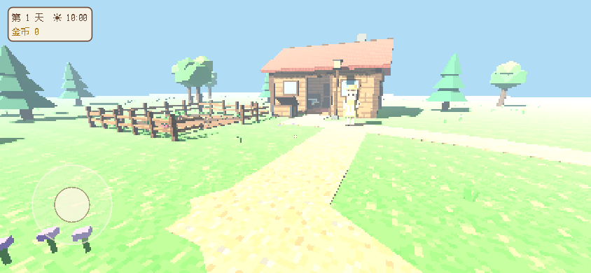
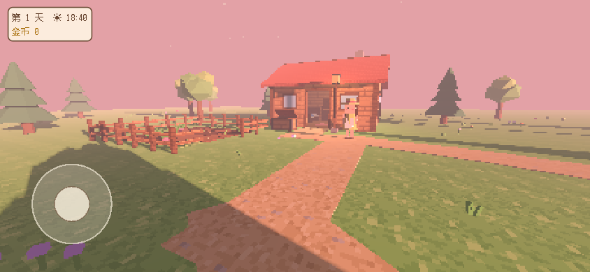
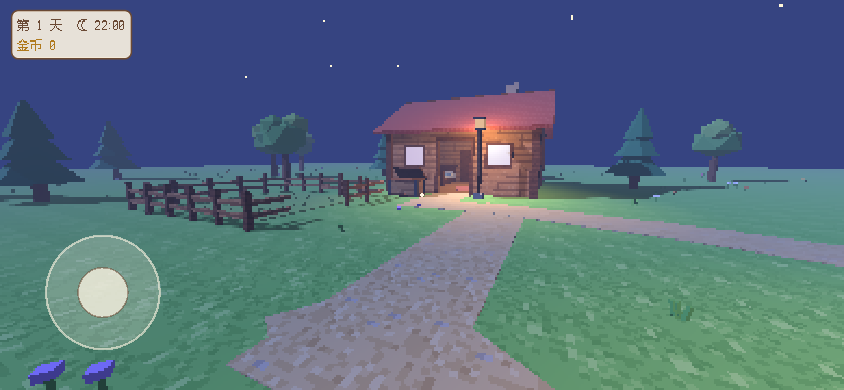
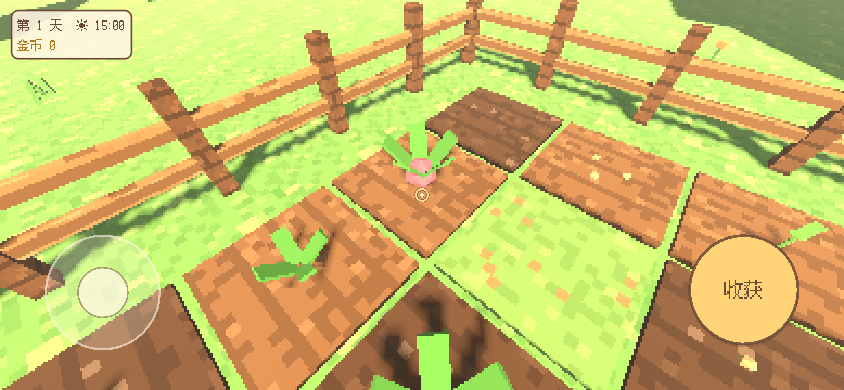
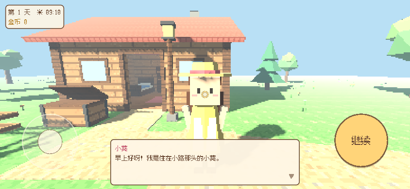

# 像素小镇（v0.1）

一款温馨治愈的手机第一人称像素种田小游戏，灵感来自星露谷物语。
3D 低多边形场景 + 低分辨率渲染（320×180 左右）后最近邻放大，呈现像素颗粒感。



| 黄昏 | 夜晚 | 种田 | 对话 |
| --- | --- | --- | --- |
|  |  |  |  |

## 下载

安卓 APK（arm64，debug 密钥签名）在 GitHub Releases（由 `.github/workflows/android-release.yml` 自动构建发布）：
https://github.com/snodgrasssanderfer-source/godot-test/releases

第一次安装要允许"安装未知来源应用"。debug 签名的 APK 只适合自己测试，不能上架应用商店。

## 怎么玩

- **左下角摇杆**：移动（手指按在屏幕左半边任意位置，摇杆就会出现在手指下）。
- **右半屏滑动**：转动视角。
- **右下角大按钮**：根据准星对着的东西自动变化：
  - 田地：锄地 → 播种 → 浇水 → （浇过水的作物每过一天长一阶，3 天成熟）→ 收获
  - 出货箱：出货（第二天早上按每个 40 金币结算）
  - 小葵：对话（每天的台词不同）
  - 床：睡觉（进入下一天并自动存档）
- 一天从 06:00 到 24:00，大约 10 分钟现实时间。到 24:00 时钟会停住，不会强制睡觉。
  没有体力、没有失败、没有时间压力。种子不限量。
- 电脑上测试：WASD/方向键移动，鼠标拖动转视角，E/空格是动作键。

## 版本

| 组件 | 版本 |
| --- | --- |
| Godot | 4.7.2-stable（导出模板版本完全一致） |
| 渲染器 | Compatibility（OpenGL ES 3.0，中端手机友好；网页测试版也用它） |
| Blender | 5.1.2（建模脚本） |
| OpenJDK | 17（Godot 4.7 文档推荐） |
| Android SDK | cmdline-tools 最新版、platform-tools、build-tools 35.0.1、platforms;android-35 |
| APK | arm64-v8a，minSdk 24（Android 7.0），targetSdk 36，不需要任何权限 |
| 字体 | Fusion Pixel Font 12px 简体中文（SIL OFL 1.1），按游戏用到的字裁剪到 38 KB |
| MCP | 沿用仓库根目录 `.mcp.json`：godot-mcp（`run_project` 的 projectPath 填 `/home/user/godot-test/pixel-town`）和 blender-mcp |

## 项目结构

```
pixel-town/                     Godot 项目
  project.godot                 横屏、1280×720 画布、Compatibility 渲染器、像素字体
  export_presets.cfg            "Android"（arm64 APK）和 "Web"（只用于截图测试）
  main.tscn                     入口场景（节点都在代码里创建）
  icon.png                      应用图标（由 art/pixel-town/make_icon.py 生成）
  scripts/
    main.gd                     低分辨率 3D 视口 + UI、动作按钮分发、睡觉流程、调试启动参数
    game_state.gd               全局状态（autoload "Game"）：时钟、金币、背包、田地、存档
    audio.gd                    音效和环境音（autoload "Sfx"），按时间在鸟叫/风声和虫鸣之间淡入淡出
    world.gd                    搭建小镇（木屋、田地、栅栏、小路、树、花草、云、星星）和昼夜光照
    player.gd                   第一人称移动/视角平滑、走路晃动和脚步声、准星射线
    touch_controls.gd           摇杆、滑动转视角、情境按钮（多点触控）
    hud.gd                      天数/时间/金币、准星、提示、对话框、睡觉黑场
    farm_plot.gd                田地格子（状态、作物模型、动作和反馈）
    villager.gd                 居民小葵（沿小路散步、对话、晚上回家）
    shipping_bin.gd, bed.gd     出货箱、床
    interact.gd                 准星可交互物体的碰撞体（物理层 2）
    pixel_tex.gd                代码生成的 16×16 / 32×16 像素贴图（草地、小路、泥土、木板、瓦片）
    fx.gd                       粒子反馈（泥土、种子、水滴、收获、闪光）
  assets/
    models/*.glb                Blender 导出的模型
    audio/*.wav                 合成的音效和环境音（环境音在 .import 里设为循环）
    fonts/                      裁剪后的像素字体 + OFL 许可证
  tests/test_game_state.gd      无界面逻辑测试（生长、收获、结算、存档）

art/pixel-town/
  make_models.py                Blender 建模脚本：木屋、床、两种树、出货箱、路灯、栅栏、居民、4 个作物阶段
  make_audio.py                 用正弦波和滤波噪声合成全部音效
  make_icon.py                  32×32 像素图标
  models_preview.png            模型预览（Cycles CPU）
  screenshots/                  游戏截图

tools/
  setup_android.sh              安装 JDK 17、Android SDK、Godot 安卓导出模板、debug 密钥
  export_android.sh             导出并签名 APK 到 build/
  subset_font.py                重新裁剪像素字体（改了游戏里的文字后要运行）
```

设计要点：
- **像素感**：3D 世界渲染在 `SubViewport` 里，`stretch_shrink = 4`（1280×720 画布对应 320×180），
  用最近邻放大。UI 按全分辨率绘制，文字和按钮清晰好按。
- **贴图**：地面、小路、泥土、墙面木板和屋顶瓦片都是代码生成的小像素贴图，关闭了过滤。
  Blender 模型只有纯色材质，游戏里按材质名（`Wood`、`WoodDark`、`FloorWood`、`Roof`）
  换成像素贴图（用世界坐标三平面映射，像素保持方正）。
- **颜色**：建模脚本里的调色板写的是 sRGB 值，导出前会转成线性值（glTF 要求线性颜色，否则模型会偏白）。
- **碰撞**：Blender 里对象名以 `-col` 结尾，Godot 导入时会自动生成静态碰撞体。

## 重新导出 APK

```bash
tools/setup_env.sh          # Godot + Blender（新会话第一次需要）
tools/setup_android.sh      # JDK 17 + Android SDK + 安卓导出模板 + debug 密钥（约 3 分钟）
tools/export_android.sh     # 输出 build/pixel-town-v<版本>.apk，并用 apksigner 验证签名
```

- 版本号在 `pixel-town/export_presets.cfg` 里（`version/name` 和 `version/code`）。
- **发布新版本**：改大版本号，在 `pixel-town/CHANGELOG.md` 写更新内容，然后 push。
  GitHub Actions（`.github/workflows/android-release.yml`）发现这个版本还没有 Release，
  就会在云端安装 Godot 和 Android SDK、跑逻辑测试、导出 APK，
  再创建 `pixel-town-v<版本>` Release 并上传 APK。版本已经发布过的话会直接跳过。
- CI 每次构建都会生成新的 debug 密钥，所以不同版本的签名不一样，升级时可能要先卸载旧版。
  以后要让签名固定，把自己的 keystore 存进仓库的 Actions secrets，在工作流里传给 `GODOT_ANDROID_KEYSTORE_*` 即可。
- 签名用的是标准 Android debug 密钥（`~/.android/debug.keystore`，密码 `android`），
  通过 Godot 的 `GODOT_ANDROID_KEYSTORE_*` 环境变量传入，不写进仓库。
  以后要上架的话，换成自己的 release 密钥即可。
- 改了模型：`blender --background --factory-startup --python art/pixel-town/make_models.py`
- 改了音效：`python3 art/pixel-town/make_audio.py`
- 改了游戏里的中文文字：`python3 tools/subset_font.py`（否则新字显示不出来）

### 测试

```bash
godot --headless --path pixel-town --script res://tests/test_game_state.gd   # 逻辑测试
godot --headless --path pixel-town --quit-after 300                           # 启动检查
```

调试启动参数（截图和测试用）：`--pt-pos=x,z,朝向角度,俯仰角度` 指定出生位置，
`--pt-hour=19` 设置时间，`--pt-demo-farm` 让田里出现所有生长阶段。
在网页测试版里，把这些参数写进导出的 `index.html` 里 `GODOT_CONFIG` 的 `args` 数组。

已知情况：无界面模式退出时，Godot 会打印 "ObjectDB instances leaked / resources still in use"。
这是无界面音频驱动的问题：只要退出时还有声音在播放就会出现，一个最小项目也能复现，不影响游戏。

## 后续计划

- **季节**：春夏秋冬轮换，每季可种的作物不同，景色（树叶颜色、地面、天气）跟着变；加入雨天（下雨自动浇水）。
- **钓鱼**：小镇边加一条小河和码头，做一个轻松的钓鱼小游戏（不会失败），鱼可以出货或收藏。
- **更多居民**：杂货店老板、渔夫、小孩等，每人有自己的作息、住处和好感度，节日活动。
- **小镇扩建**：用金币扩建木屋、多开几块田、加鸡舍和温室，商店买不同的种子和装饰。
- **其他**：种子商店（种子不再免费）、背包和物品栏、背景音乐、更多作物、设置菜单（灵敏度、音量）、
  正式签名并上架。
